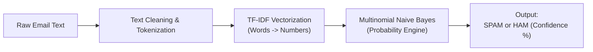

# 🛡️ AI Email Spam Detection System

A simple, beginner-friendly **Machine Learning & Natural Language Processing (NLP)** project that classifies incoming emails and SMS messages as **Spam** or **Ham (Legitimate)** with **98.3% accuracy**.

Built using Python, Scikit-Learn, and Streamlit.

---

## 🏛️ Program Background & Acknowledgments

This project was developed as part of the **Deutsche Bank Training Program** conducted by **Rubicon**.

- **Program:** Deutsche Bank Youth Employability / Graduate Training Program
- **Training Partner:** Rubicon
- **Mentor:** Amol Navgire
- **Domain:** Artificial Intelligence & Machine Learning (AI/ML) & Natural Language Processing (NLP)

Special thanks to mentor **Amol Navgire** and the training teams at **Rubicon** and **Deutsche Bank** for their continuous guidance, technical insights, and mentorship throughout this training program.

---

## 🌟 Features

- **High Accuracy & Precision:** Trained on 5,500+ real-world messages achieving **98.30% accuracy** and **98.51% precision**.
- **Self-Contained Pipeline:** Uses TF-IDF (Term Frequency-Inverse Document Frequency) vectorization bundled with a Multinomial Naive Bayes classifier.
- **Dual Interfaces:**
  1. 🌐 **Interactive Web App (Streamlit):** Beautiful web UI with real-time probability gauges, preset examples, and keyword detection.
  2. 💻 **Command-Line Predictor (CLI):** Quick terminal tool supporting both single-line arguments and interactive loops.
- **Zero Heavy Setup:** No complex external downloads (e.g. NLTK corpora) required. Everything runs reliably out of the box.
- **Pre-trained Model Ready:** Includes serialized `model.pkl` so you can test predictions immediately without waiting to train.

---

## 📊 Model Performance & Metrics

Evaluated on a 20% stratified test set (1,115 messages):

| Metric | Score | Explanation |
| :--- | :--- | :--- |
| **Accuracy** | **98.30%** | Overall correct classifications across all emails |
| **Precision (Spam)** | **98.51%** | When an email is marked as spam, it is truly spam 98.5% of the time |
| **Recall (Spam)** | **88.59%** | Catches almost 9 out of 10 spam messages |
| **F1 Score** | **93.29%** | Harmonic balance between precision and recall |
| **False Positives** | **Only 2 / 966** | Crucial: legitimate emails rarely get marked as spam |

---

## 📁 Project Structure

```text
Email-Spam-Detection/
│
├── spam.csv            # SMS / Email spam dataset (5,572 rows)
├── train.py            # Loads data, trains models, evaluates & saves model.pkl
├── predict.py          # Fast CLI prediction tool (interactive or arguments)
├── app.py              # Streamlit interactive web application
├── model.pkl           # Saved trained model pipeline (TF-IDF + Naive Bayes)
├── requirements.txt    # Python dependencies (pandas, scikit-learn, joblib, streamlit)
├── run_web_app.bat     # Windows 1-click launcher for the Streamlit Web App
├── run_cli.bat         # Windows 1-click launcher for the CLI predictor
└── README.md           # Project documentation & beginner guide
```

---

## 🚀 Quick Start Guide

### 1. Prerequisites
Make sure you have **Python 3.9 - 3.12** installed on your system.

### 2. Environment Setup (First Time Only)

Open your terminal or PowerShell in this project folder:

```powershell
# Create a virtual environment
python -m venv .venv

# Activate the virtual environment
# On Windows (PowerShell):
.\.venv\Scripts\Activate.ps1
# On Windows (Command Prompt):
.\.venv\Scripts\activate.bat
# On macOS / Linux:
source .venv/bin/activate

# Install dependencies
pip install -r requirements.txt
```

---

## 🎮 How to Run

### Method 1: Interactive Web App (Recommended)

Run the Streamlit web dashboard:
```powershell
streamlit run app.py
```
*(Or on Windows, simply double-click `run_web_app.bat`)*

It will automatically open `http://localhost:8501` in your browser. You can:
- Select preset examples from the sidebar with 1 click.
- Paste your own email text into the input box.
- View live confidence percentages and detected trigger keywords.

---

### Method 2: Command-Line Predictor (CLI)

#### A. Direct Argument Mode:
Pass any text directly in quotes:
```powershell
python predict.py "CONGRATULATIONS! You won a $1,000 cash prize! Call 0800 now to claim."
```

#### B. Interactive Prompt Mode:
Run without arguments to enter an interactive session:
```powershell
python predict.py
```
*(Or on Windows, double-click `run_cli.bat`)*

Type or paste any message and press **Enter** to see the prediction and spam probability.

---

### Method 3: Retraining the Model

If you modify `spam.csv` or want to inspect the training process and evaluation metrics:
```powershell
python train.py
```
This script will:
1. Load and clean `spam.csv`.
2. Vectorize text with **TF-IDF**.
3. Train and compare **Multinomial Naive Bayes** against **Logistic Regression**.
4. Output the confusion matrix and classification report.
5. Save the updated pipeline to `model.pkl`.

---

## 🧪 Try These Sample Inputs

### 🚨 Example Spam Messages to Test:
- *"WINNER!! You have been selected to receive a £900 prize reward! Call 09061701461 to claim your reward. Code: KL341."*
- *"URGENT! Your account has been temporarily suspended due to security concerns. Click here to verify your identity."*
- *"Free entry into our £100,000 prize jackpot! Text CLAIM to 81010 to enter now."*

### ✅ Example Legitimate (Ham) Messages to Test:
- *"Hi John, can you please review the attached slide deck before our client presentation at 2 PM?"*
- *"Hey! Are we still on for lunch tomorrow? Let me know what time works best for you."*
- *"Thanks for sending over the invoice. I've forwarded it to accounting for processing."*

---

## 🧠 How It Works (For Beginners)



1. **Text Preprocessing:**
   Raw emails contain varied casing and formatting. We clean whitespace, convert text to lowercase, and filter out common English stopwords (*"is"*, *"at"*, *"the"*).

2. **TF-IDF Vectorizer (Term Frequency - Inverse Document Frequency):**
   Machine learning algorithms cannot read raw strings; they require numbers.
   - **TF (Term Frequency):** Measures how frequently a word appears in a specific email.
   - **IDF (Inverse Document Frequency):** Reduces the importance of words that appear everywhere, and increases the importance of rare, distinctive keywords (like *"lottery"*, *"claim"*, *"jackpot"*).

3. **Multinomial Naive Bayes:**
   Based on Bayes' Theorem, this algorithm calculates the mathematical probability of a document belonging to a class (*Spam* vs. *Ham*) based on the frequencies of the words it contains. It is exceptionally fast and historically the industry-standard baseline for spam filtering.

4. **Classification & Decision:**
   If the computed probability of being spam exceeds 50%, the message is classified as **Spam**; otherwise, it is marked as **Ham (Legitimate)**.
